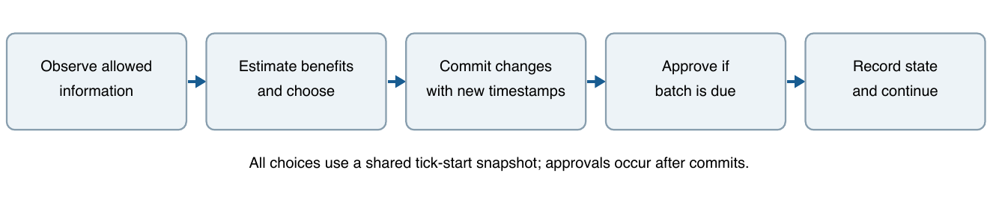
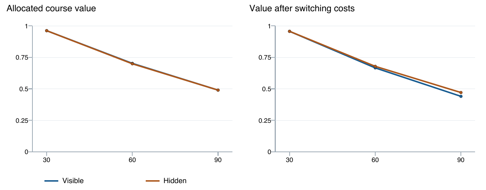
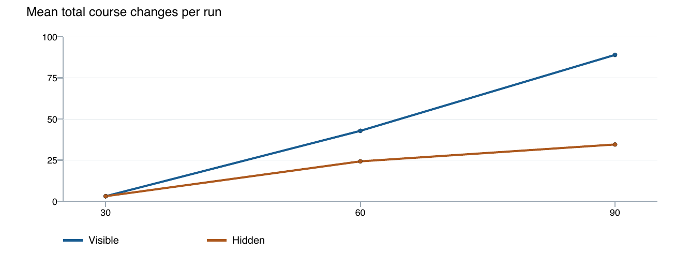
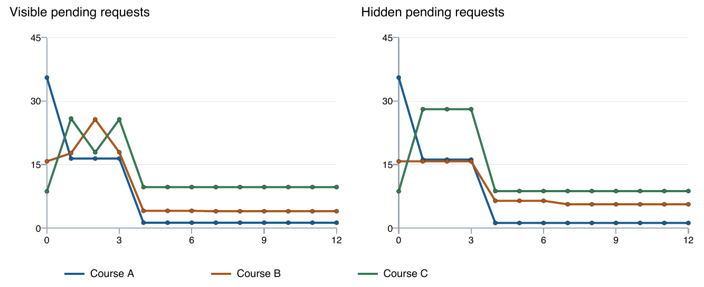
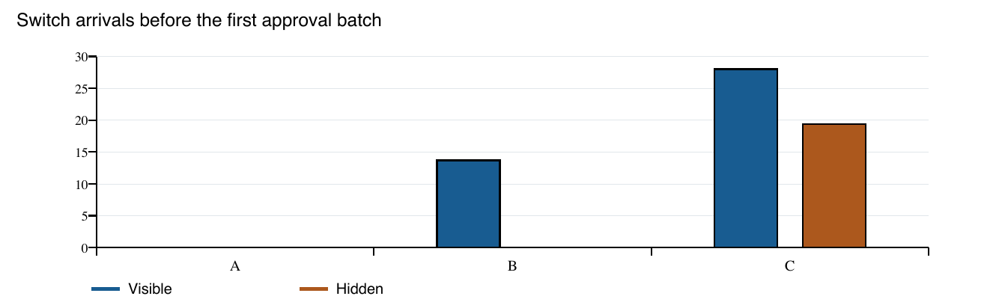

# Queue Position Visibility in HKU Common Core Course Selection

**Interim research progress report | 20 October 2026**

Team: [Member 1], [Member 2], [Member 3], [Member 4], [Member 5]

## Progress and preliminary findings

We have implemented and checked a small synthetic simulation of the question in our Project Plan: how does seeing one's queue position change course-selection decisions and the distribution of requests? The completed pilot has 300 runs, arranged as 150 visible/hidden pairs. The results show a trade-off: more rank information can improve placement while inducing extra changes that reduce net utility under an assumed cost.

| Students | Placement V / H | Changes V / H | Net utility V / H |
| --- | --- | --- | --- |
| 30 | 100.0% / 100.0% | 3.0 / 3.0 | 0.9565 / 0.9565 |
| 60 | 75.0% / 73.9% | 42.8 / 24.2 | 0.6661 / 0.6784 |
| 90 | 50.0% / 49.8% | 89.0 / 34.5 | 0.4402 / 0.4704 |

V = visible; H = hidden. Entries are means across 30 matched seeds; each run has 45 seats. Utilities are synthetic preference units per original student, including those left unplaced. Values rounded for presentation; complete precision is retained in CSV files.

At N=60, visible students obtained mean allocated-course value 0.7018, compared with 0.6986 when rank was hidden. After deducting change costs, the comparison became 0.6661 versus 0.6784. The small average value gain was not consistent across seeds: only 11 of 30 paired raw-utility differences were positive.

### Completed work

- Specified queue states, timestamp surrender, allowed information, belief rules, decision order and output definitions.

- Checked an analytic two-person example and 15 automated tests; exported decision, event, student, flow and round records.

- Completed the main 180 runs and 120 sensitivity runs; rechecked eight references and official HKU rules.

The findings are conditional on this model. No real student records were used, and no effect on actual SIS/server congestion has been measured.

<!-- page break -->

## Model and event order

The model represents the ordinary FCFS selection period. Public HKU guidance provides the institutional basis; one-course demand, utility values and the precise event schedule are our simplifying assumptions (HKU Common Core, n.d.-a, n.d.-b).

| Setting | Implemented value |
| --- | --- |
| Courses and capacities | A, B, C; 15 seats each; fixed throughout a run |
| Students and initial preference | N = 30, 60 or 90; favourite probabilities 0.60, 0.25, 0.15 |
| Course values | Favourite = 1; alternatives independently Uniform(0.3, 0.8) |
| Revision effort cost | 0.05 per actual switch; 0.15 in the higher-cost check |
| Timing | 12 ticks; approval after ticks 3, 6, 9 and 12 |
| Expected departures | 0.10 before the next approval, used only as a belief |
| Rank refresh | Every tick; every third tick in the slower-refresh check |

Figure 1. Decisions are computed before any switch is committed. The sequence repeats for 12 ticks.

Students submit to their favourites initially; a seeded permutation supplies their timestamps. Only pending students revise. All revisions use the tick-start snapshot, then a shared random commit order gives new timestamps. Approval takes the earliest requests up to capacity. Full courses accept no new requests, but existing pending requests are retained until final expiry.

Approved students do not drop in this baseline. There are no later arrivals or external random withdrawals. Consequently, new places stop appearing once all seats are filled. The 15-seat setting is a scaled example: HKU's real under-20-enrolment cancellation rule is explicitly omitted and is not represented by these capacities.

<!-- page break -->

## How information changes a decision

Both arms know vacancies and their approval status. Visible agents additionally know their own latest disclosed rank. They never observe the true queue for an alternative course. A rank is tied to its course and invalidated on switching; between refreshes a retained rank may be stale.

For own rank r and v vacancies, the next-approval forecast is **g(r,v) = P[Binomial(r-1, 1-rho) < v]**. Rho is the subjective probability that someone ahead leaves before that batch. Real departures are generated by other agents' decisions, so this forecast may be wrong.

Hidden agents estimate pending demand as lambda_j = max(0, N*s_j - a_j), where s_j is the synthetic favourite share and a_j is publicly inferable approvals. With m = max(1, ceil(lambda_current)), they average g over ranks 1 through m. Both arms forecast a new alternative request using P[Poisson(lambda_j*(1-rho)) < v_j]. These are explicit heuristics, not calibrated HKU admission probabilities or optimal Bayesian strategies.

An agent switches only if value(alternative)*forecast(alternative) - cost exceeds value(current)*forecast(current). Ties stay. This decision concerns the next batch, not a full forward-looking equilibrium. We separately measure final realised utility.

### Hand calculation checked against the program

A and B each have one seat. S values A=10, B=5 and pays cost 1; the other student stays with A. Set rho=0. The two initial orders are equally likely. Hidden S estimates a 50% chance at A, so staying is worth 5 versus 4 for switching.

| Actual rank of S | Visible choice and net result | Hidden choice and net result |
| --- | --- | --- |
| 1 | Stay at A: 10 | Stay at A: 10 |
| 2 | Switch to B: 5 - 1 = 4 | Stay at A, no seat: 0 |
| Equal-weight expectation | (10 + 4)/2 = 7 | (10 + 0)/2 = 5 |

This constructed example shows that useful information can improve a decision. It is checked in the same engine using controlled inputs. Its values and fixed second student differ from the larger pilot; it is not a general proof that visibility improves outcomes.

<!-- page break -->

## Outcomes across competition levels

Figure 2. Mean raw and net preference utility versus N. Each point averages 30 seeds; the total capacity remains 45. Lines connect tested settings only.

Figure 3. Mean total course changes per run. More changes can help obtain a seat or add effort costs; counts alone do not establish irrational behaviour.

At N=30, both arms placed every student and their mean utilities were almost identical. At N=90, visible agents made 89.0 changes versus 34.5; mean net utility was 0.4402 versus 0.4704. Scarcity and the cost assumption therefore matter to the information/outcome relationship.

For N=60, the SD of the 30 paired raw-utility differences was 0.0224, larger than their mean difference of 0.0032. We report both the mean and variation; the data do not establish a stable universal welfare gain. These are Monte Carlo outcomes under chosen assumptions, not statistical estimates from HKU students.

<!-- page break -->

## Application distribution and switching flows

Figure 4. Mean pending requests at N=60. Tick 0 is initial; later observations are after changes but before that tick's approval. The first approval is after tick 3. Approved students are no longer counted in these queues.

Figure 5. Mean switch-arrival events to each course in ticks 1-3, averaged over 30 runs. Repeated arrivals by the same student count as separate events.

The exported flow counts identify where changes go, while the queue trajectories identify whether those changes accumulate. Together they allow us to investigate concentration on alternatives. They do not reveal whether real students herd.

Pending HHI is also exported, but it can rise merely because a small number of unsuccessful students remain in one queue. For that reason, we do not interpret a high peak HHI as sufficient evidence of harmful herding. We retain total pending counts, capacities and actual inflows/outflows for the same observation phase.

<!-- page break -->

## Sensitivity checks and limitations

| N=60 setting | V changes | H changes | V net | H net |
| --- | --- | --- | --- | --- |
| Baseline | 42.8 | 24.2 | 0.6661 | 0.6784 |
| Cost 0.15 | 39.1 | 17.7 | 0.6037 | 0.6698 |
| Refresh every 3 ticks | 21.4 | 24.2 | 0.6837 | 0.6784 |

Raising the change cost reduced switching in both arms but did not remove the net-utility disadvantage of visibility in that tested setting. Changing rank refresh to every third tick reduced visible-arm changes and reversed the sign of the mean visible-minus-hidden net comparison. Only 13 of the 30 slower-refresh paired net differences were positive, however, so this mean reversal is not a reliable recommendation for every population.

Raw utility is the value of the assigned course, zero if unplaced, averaged over all original students. Net utility subtracts every actual switching cost, including costs paid by those eventually unplaced. All generated course values are positive, so acceptable placement equals placement. Neither metric is an observed measure of real satisfaction.

The operation index is scheduled status checks + 2*switches. Rank refreshes are separately counted only in the visible arm. The schedule is imposed and public vacancy/status metadata are supplied every tick. The index omits initial requests and backend work; slower imposed checking mechanically reduces part of it. It cannot establish real traffic, latency or SIS congestion.

### Main obstacles and next experiments

| Limitation | Consequence and planned check |
| --- | --- |
| No real queue logs or measured beliefs | Treat results as conditional; vary prior multiplier 0.5/1.5 and rho 0/0.3. |
| Static forecasts and correlated actions | Compare sequential decisions with the present shared-snapshot design. |
| Synthetic values and a single desired seat | Vary alternative values to 0.1-0.4 and 0.6-0.9; report multiple-course omission. |
| No strategic drops after approval | Add an explicit withdrawal/arrival extension separately; no hidden withdrawal process in this pilot. |

The follow-up scenarios above are specified but not included in the 300 completed runs. No personal data are collected. Any later student survey would require consent and careful handling of responses.

<!-- page break -->

## Literature and mechanism audit

**HKU selection guidance.** HKU Common Core (n.d.-a) documents ordinary August timestamped FCFS, position/vacancy visibility, periodic approval, CCTM priority exceptions and a separate auto-ballot add/drop period. It establishes procedure, not behavioural effects. Exact FCFS batch times are not stated.

**HKU FAQ.** HKU Common Core (n.d.-b) clarifies surrender of queue position, full-class closure and approved-course drop/add. Therefore one-course demand and frozen approved allocations are model simplifications, not HKU restrictions. The exact interaction of pending approvals and reopening remains unspecified.

**Course allocation and manipulation.** Budish and Cantillon (2012) use theory and Harvard field data to identify manipulation and welfare costs in a course draft, while the draft can outperform its studied alternative. The paper does not isolate personal FCFS rank visibility.

**Matching mechanisms.** Diebold et al. (2014) review stable matching and include a field experiment. This supports mechanism/incentive analysis; it is not an evaluation of a rank-display treatment in the present model.

**Strategic adjustments.** Romero-Medina and Triossi (2024) study conditional acceptance and repeated adjustment. Their adjustment mechanism differs from HKU drop/rejoin, including restrictions on dropping allocated courses. It supports examining revisions, not importing their conclusions.

**Information and search.** Arteaga et al. (2022) study personalised placement-risk feedback in Chile and New Haven using experimental/quasi-experimental designs. Feedback can help search and placement. New Haven uses truncated DA; the settings are not university FCFS queues.

**Information and distributions.** Sato and Shirakawa (2025) theoretically connect disclosure of admissions priorities with application distributions. They do not empirically study repeated course-queue revision or the present timestamp mechanism.

**Feedback in another queueing setting.** Zou et al. (2026) simulate information quality, frequency and adoption in Hong Kong emergency departments. This motivates robustness checks but supplies no direct evidence about course selection or SIS performance.

The 20 October targeted search found limited direct evidence on the joint combination of personal rank visibility, FCFS timestamps, loss of a surrendered position and repeated course revision. This is not an exhaustive review or a claim of first discovery. The separate source audit records URLs, access limits and adjacent studies; some articles were checked through abstracts/primary records rather than a full-text reading.

<!-- page break -->

## Reproducibility and references

The 15 checks cover analytic probabilities, tie handling, capacity, timestamp surrender, the worked example, paired population identity, repeatability, hidden information boundaries, course-specific rank-cache invalidation, synchronous action and export/flow conservation. The saved manifest records 300 runs, 150 pairs and file hashes.

Run from the workspace root: **python3 -m unittest discover -s study/tests -v**, then **python3 -m study.run_study --output progress/results**. The simulator requires only standard Python 3.10+. Defaults and each scenario's effective configuration are saved in resolved_config.json.

Evidence: runs.csv and students.csv contain final outcomes; decisions.csv contains policy inputs/forecasts; events.csv records switches, approvals and expiry; rounds.csv and flows.csv support the figures. summary.csv and paired_summary.csv retain variation and pairwise comparisons. See study/README.md and study/model_spec.md for definitions.

### References

Arteaga, F., Kapor, A. J., Neilson, C. A., & Zimmerman, S. D. (2022). Smart matching platforms and heterogeneous beliefs in centralized school choice. *The Quarterly Journal of Economics, 137*(3), 1791–1848. https://doi.org/10.1093/qje/qjac013

Budish, E., & Cantillon, E. (2012). The multi-unit assignment problem: Theory and evidence from course allocation at Harvard. *American Economic Review, 102*(5), 2237–2271. https://doi.org/10.1257/aer.102.5.2237

Diebold, F., Bichler, M., Matthes, F., Schneider, A., & Aziz, H. (2014). Course allocation via stable matching. *Business & Information Systems Engineering, 6*(2), 97–110. https://doi.org/10.1007/s12599-014-0316-6

HKU Common Core. (n.d.-a). *Common Core course selection*. https://commoncore.hku.hk/cccourseselection/

HKU Common Core. (n.d.-b). *Frequently asked questions on Common Core*. https://commoncore.hku.hk/faqs/

Romero-Medina, A., & Triossi, M. (2024). Strategic priority-based course allocation. *Journal of Economic Behavior & Organization, 226*, 106701. https://doi.org/10.1016/j.jebo.2024.106701

Sato, H., & Shirakawa, R. (2025). Information structures in college admissions. *Journal of Economic Behavior & Organization, 240*, 107322. https://doi.org/10.1016/j.jebo.2025.107322

Zou, C., Zhang, Y., Ouyang, H., & Sun, Z. (2026). Impact of announced wait time information on emergency department overcrowding mitigation: A simulation study. *Journal of the American Medical Informatics Association, 33*(6), 1112–1120. https://doi.org/10.1093/jamia/ocag036

Official web guidance and citation metadata rechecked 20 October 2026. The original Project Plan remains unchanged; this report records the subsequent implementation and pilot.

